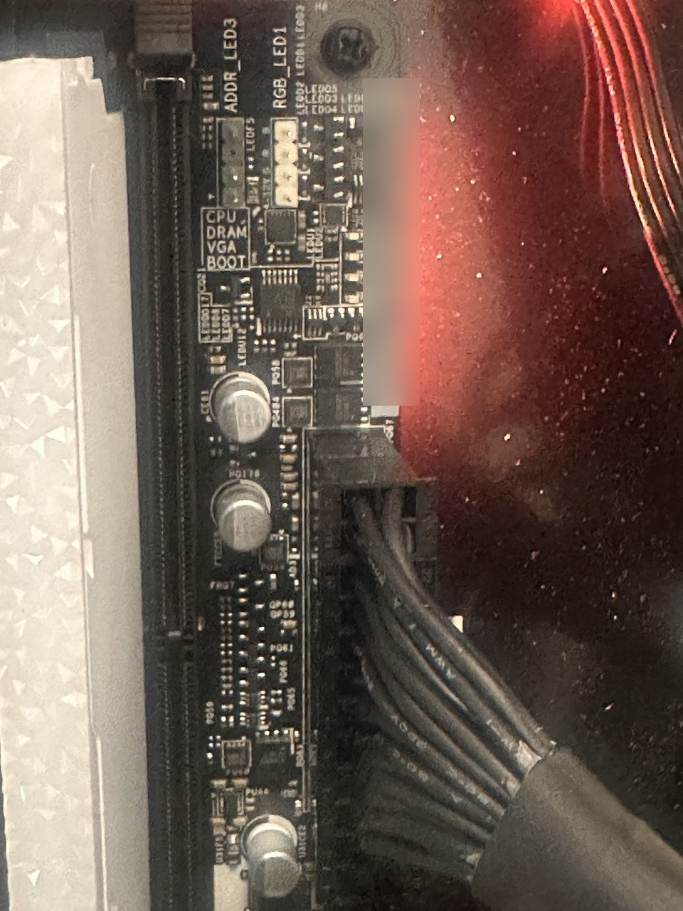
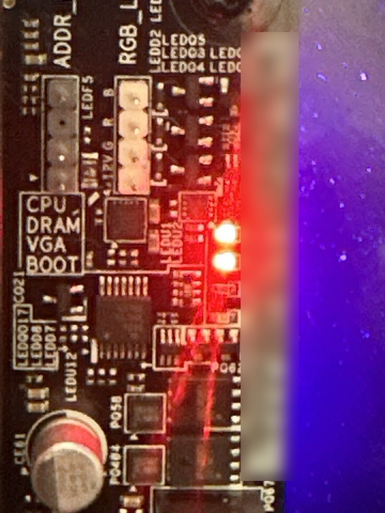
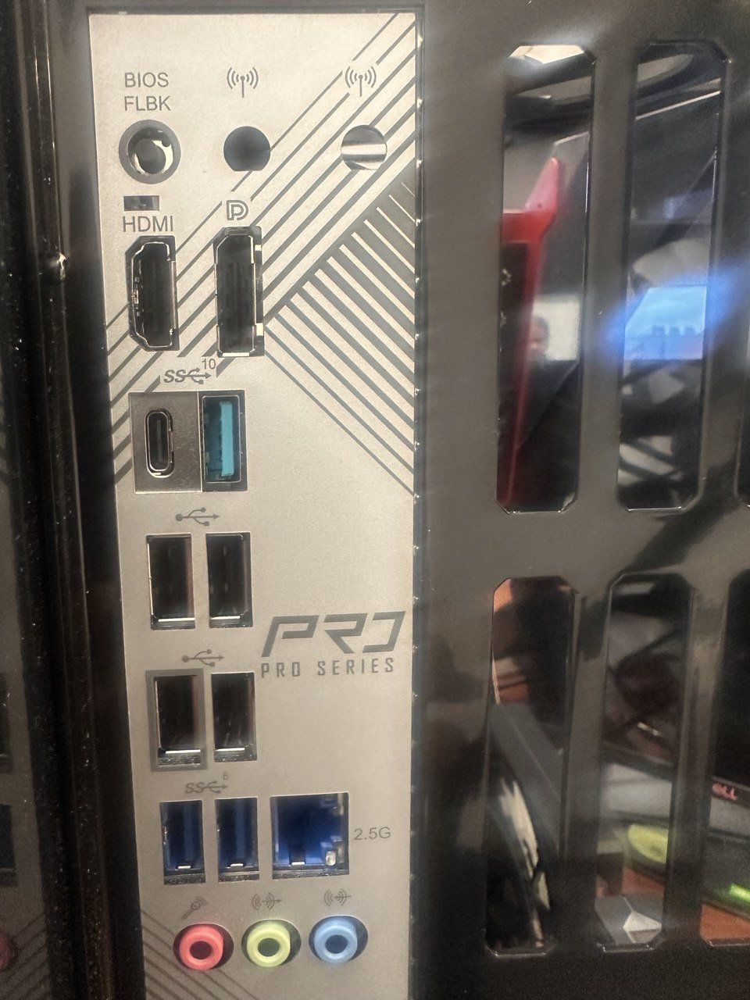
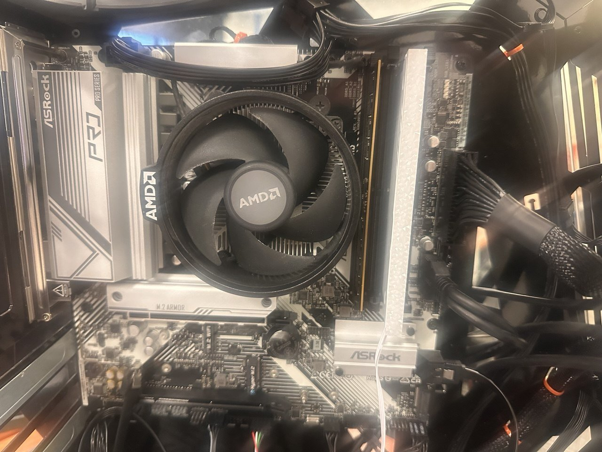
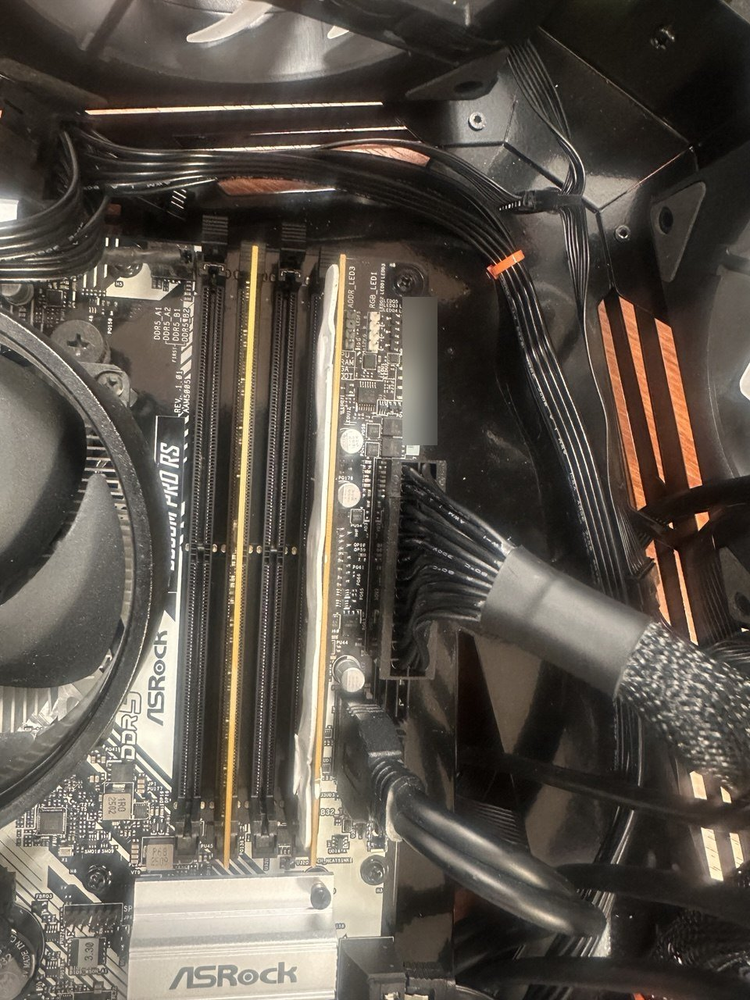

# Recovering a New AMD Ryzen 9000 Desktop Build Stuck on CPU and DRAM Debug Lights

**Author:** Dr. Solomon Seifu

**Category:** Hardware troubleshooting, firmware recovery, and system bring-up

**Platform:** AMD Ryzen 5 9600X | ASRock B650M Pro RS | DDR5 memory (two modules) | Integrated graphics

**Outcome:** The system passed its power-on self-test (POST) after a verified BIOS Flashback update and a memory slot correction.

---

## Table of Contents

1. [Background](#1-background)
2. [Hardware Configuration](#2-hardware-configuration)
3. [The Problem](#3-the-problem)
4. [Key Concepts](#4-key-concepts)
5. [Troubleshooting Timeline](#5-troubleshooting-timeline)
6. [Diagnosis: Reading the Debug LEDs](#6-diagnosis-reading-the-debug-leds)
7. [Fix Part 1: Updating the BIOS with Flashback](#7-fix-part-1-updating-the-bios-with-flashback)
8. [Fix Part 2: Correcting the Memory Slot Placement](#8-fix-part-2-correcting-the-memory-slot-placement)
9. [Result](#9-result)
10. [What Did Not Cause the Problem](#10-what-did-not-cause-the-problem)
11. [Lessons Learned](#11-lessons-learned)
12. [Quick Troubleshooting Checklist](#12-quick-troubleshooting-checklist)
13. [Glossary](#13-glossary)
14. [References](#14-references)

---

## 1. Background

A learner assembled a new desktop computer from individual parts. When the system was powered on for the first time, the fans spun but nothing appeared on the screen. I worked through the problem step by step, using the motherboard's built-in diagnostic lights to identify where the startup process was failing.

This write-up documents the full process: the symptoms, the reasoning behind each step, the exact commands and procedures used, the mistakes and dead ends along the way, and the final fix. It is written so that a beginner can follow it, and so that it can serve as a teaching case for hardware and firmware troubleshooting.

---

## 2. Hardware Configuration

| Component | Detail | Notes |
| --- | --- | --- |
| CPU | AMD Ryzen 5 9600X | Ryzen 9000 series, AM5 socket, includes integrated graphics |
| Motherboard | ASRock B650M Pro RS | Micro-ATX, non-WiFi version, four DDR5 slots, BIOS Flashback support |
| Memory | Two DDR5 modules | Initially installed in slots A1 and B1 |
| Graphics | None (integrated graphics only) | Display must connect to the motherboard HDMI or DisplayPort |
| Cooling | AMD stock cooler | Shipped with the CPU |
| Power supply | ATX power supply with 24-pin and 8-pin CPU connectors | Rear rocker switch marked I (on) and O (off) |

**Confirming the exact board model.** ASRock sells both a B650M Pro RS and a B650M Pro RS WiFi, and they use different BIOS files. The model was confirmed from the name printed on the board next to the memory slots, which reads B650M PRO RS with no "WiFi." The rear antenna holes were also empty, with no gold threaded connectors, which is consistent with the non-WiFi model.

---

## 3. The Problem

On power-on:

- The fans spun, so the board was receiving power.
- The screen showed "No Signal."
- Two of the four motherboard debug LEDs stayed lit: CPU and DRAM.
- The system never reached the ASRock logo screen.


*Figure 1. The debug LED area with the system powered off. The labels CPU, DRAM, VGA, and BOOT sit beside a column of four small status LEDs. With no power, all four are off, which is normal.*


*Figure 2. After power-on, the two upper LEDs (CPU and DRAM) stayed lit. This means the board was stuck at the very first stage of startup, initializing the processor and memory.*

---

## 4. Key Concepts

These terms are needed to follow the troubleshooting.

- **POST (Power-On Self-Test):** The checks the motherboard runs every time it starts, before any operating system loads. It tests the CPU, memory, graphics, and boot devices in order.
- **Debug LEDs:** Small lights on the motherboard that show which POST stage is running. If startup stops, the LED for the failing stage stays lit.
- **BIOS / UEFI firmware:** The software built into the motherboard that runs POST and starts the computer. It must know how to work with the installed CPU.
- **AGESA:** AMD's firmware code that motherboard makers include in their BIOS. Newer CPUs require newer AGESA versions.
- **BIOS Flashback:** A motherboard feature that updates the BIOS directly from a USB drive, using only power from the power supply. It works even when the CPU, memory, or screen is not working.
- **Memory training:** A process during POST where the board tests and tunes timing settings for the installed memory. New DDR5 memory can take several minutes to train on the first start.
- **SHA256 hash:** A unique "digital fingerprint" of a file. If even one bit of the file changes, the hash changes completely. It is used to confirm that a download is complete and has not been tampered with.

---

## 5. Troubleshooting Timeline

Real troubleshooting rarely goes in a straight line. This is the actual order of events, including the dead ends.

| Step | What happened | What it told us |
| --- | --- | --- |
| 1 | Pressed the power button and nothing happened at all | The power supply was not plugged into the wall. A desktop has no battery. |
| 2 | Plugged in the power cord and set the power supply switch to I | The board powered on and the fans spun. |
| 3 | Connected HDMI to a screen, which showed "No Signal" | The screen worked, but the computer was not sending a picture. |
| 4 | Considered using a laptop as the screen | Not possible. A laptop HDMI port is output only. It cannot receive a picture without a USB capture card. |
| 5 | Photographed the debug LEDs before and after power-on | CPU and DRAM stayed lit, so startup was failing at the first stage. |
| 6 | Waited 10 minutes for possible first-start memory training | No change. The lights stayed on. |
| 7 | Identified the most likely cause as an outdated BIOS | The Ryzen 9000 series is newer than many B650 boards, so early BIOS versions may not support it. |
| 8 | Downloaded BIOS 4.60 and verified it with SHA256 | The file was genuine and complete. |
| 9 | Ran BIOS Flashback | The Flashback LED blinked for about 5 to 6 minutes, then turned off. The update succeeded. |
| 10 | Powered on again, but CPU and DRAM still stayed lit | A second problem existed. |
| 11 | A glare-filled photo made the lights look like VGA and BOOT | A misreading. Checking the board directly confirmed they were still CPU and DRAM. |
| 12 | Opened the case and checked the memory slots | The modules were in slots A1 and B1 (first and third), which is incorrect. |
| 13 | Moved the memory to slots A2 and B2 (second and fourth) | All debug LEDs turned off, and the fans kept running. POST passed. |

---

## 6. Diagnosis: Reading the Debug LEDs

The four debug LEDs follow the order of POST. The light that stays on points to the stage where startup stops.

| LED stays lit | POST stage | Common causes |
| --- | --- | --- |
| **CPU** | Processor initialization | BIOS does not support the CPU, 8-pin CPU power cable missing or loose, CPU not seated, bent socket pins |
| **DRAM** | Memory initialization and training | Memory in the wrong slots, module not fully seated, faulty or mismatched modules, long first-time training |
| **VGA** | Display initialization | No monitor connected, wrong cable or port, wrong screen input |
| **BOOT** | Boot device search | No operating system installed yet (normal on a new build), drive not detected |
| **None** | All stages passed | The system is working and should show the logo screen on a connected display |

**Reasoning applied to this case:**

1. With CPU and DRAM both lit, the board could not get past processor and memory initialization.
2. On a B650 board with a Ryzen 9000 CPU, the most common reason for this exact pattern is a BIOS that is too old to support the CPU.
3. The second most likely cause was the memory configuration, so it was checked next.
4. Possible causes that were checked and ruled out along the way include the power connections and the display setup.

---

## 7. Fix Part 1: Updating the BIOS with Flashback

### Why Flashback

A normal BIOS update is done from inside the BIOS menu, which requires a working system. This system could not even reach the BIOS screen. BIOS Flashback solves this by writing the firmware directly from a USB drive, using only standby power from the power supply.

### Step 7.1: Download the BIOS from the official vendor site

1. On a separate working computer, I opened ASRock's official BIOS page for the B650M Pro RS:
   `https://www.asrock.com/mb/AMD/B650M%20Pro%20RS/index.asp#BIOS`
2. I confirmed the page was for the B650M Pro RS, not the WiFi version.
3. I downloaded the newest version at the top of the list:

| Version | Date | Size | Description |
| --- | --- | --- | --- |
| 4.60 | 2026/10/19 | 17.48 MB | Update AGESA to ComboAM5 1.3.0.1d |

The page lists two update methods, Instant Flash and Flashback. They use the same file. Instant Flash runs from inside the BIOS menu, so Flashback was the only option here.

> **Security note:** Only download firmware from the manufacturer's official site. A wrong or tampered BIOS file can permanently damage a motherboard.

### Step 7.2: Verify the download with SHA256

ASRock publishes a SHA256 hash for every BIOS download. I checked the downloaded file against it in PowerShell.

First, I opened PowerShell in the extracted folder (Shift + right-click inside the folder, then Open in Terminal) and hashed the extracted file:

```powershell
Get-FileHash *
```

The result did not match ASRock's hash. This was expected, because ASRock publishes the hash of the ZIP archive, not the file inside it. So I hashed the ZIP file in the parent Downloads folder:

```powershell
Get-FileHash ..\*.zip
```

| Source | SHA256 hash |
| --- | --- |
| ASRock website (version 4.60) | `8af4103f61d1b2a0005de46e062cd33adbf74512f0c13b3a3c11b51a405e1652` |
| Downloaded file `B650M Pro RS(4.60)ROM.zip` | `8AF4103F61D1B2A0005DE46E062CD33ADBF74512F0C13B3A3C11B51A405E1652` |

The two hashes match exactly. Letter case does not matter in a hash. This confirmed that the download was genuine and complete.

> **Common mistake:** When I first ran `certutil -hashfile "FILENAME" SHA256`, it failed with `ERROR_FILE_NOT_FOUND`, because "FILENAME" was only a placeholder. Either type the real file name or use `Get-FileHash *` to hash everything in the folder.

### Step 7.3: Prepare the USB drive

1. I extracted the ZIP file. It contained one file: `B65MPRS4.60.ROM`.
2. I formatted a USB flash drive as FAT32. In File Explorer: right-click the drive, choose **Format**, set **File system** to **FAT32**, and click **Start**. Drives of 32 GB or smaller work best.
3. I turned on file name extensions in File Explorer (**View > Show > File name extensions**).
4. I copied `B65MPRS4.60.ROM` to the **root** of the USB drive, not inside a folder.
5. I renamed it to exactly **`CREATIVE.ROM`**, and checked that it did not become `CREATIVE.ROM.ROM`.
6. I ejected the drive safely.

### Step 7.4: Run BIOS Flashback


*Figure 3. The rear I/O panel. The round **BIOS FLBK** button is at the top left. The Flashback USB port is the black port with a thin gray outline, on the left side of the second row of black USB ports.*

1. The computer stayed turned off. The case power button was not pressed at any point.
2. The power cord stayed plugged in, and the power supply switch stayed on I. Flashback needs standby power to work.
3. I plugged the USB drive into the outlined Flashback USB port.
4. I pressed and held the BIOS FLBK button for about 3 seconds, then released it.
5. The Flashback LED began blinking.
6. I waited about 5 to 6 minutes without touching anything.
7. The LED stopped blinking and turned off, which means the update finished.

| Flashback LED behavior | Meaning |
| --- | --- |
| Blinks for several minutes, then turns off | Update completed successfully |
| Stays solid and does not blink | Flashback could not run: check the port, the FAT32 format, and the file name |
| Does not light at all | No standby power: check the power cord, the 24-pin cable, and the power supply switch |

### Step 7.5: Restart after the update

1. Removed the USB drive.
2. Switched the power supply to O, waited about 2 minutes, and switched it back to I.
3. Pressed the case power button and waited.

**Result:** The CPU and DRAM LEDs were still lit. The BIOS update was necessary, because BIOS 4.60 fully supports the Ryzen 9000 series, but it was not enough on its own. A second problem was still present.

---

## 8. Fix Part 2: Correcting the Memory Slot Placement

### The discovery

With the power off and unplugged, I opened the case and checked the memory. The board has four slots. Counting outward from the CPU:

| Slot position | Slot name | Before | After |
| --- | --- | --- | --- |
| 1st | A1 | Module installed | Empty |
| 2nd | A2 | Empty | Module installed |
| 3rd | B1 | Module installed | Empty |
| 4th | B2 | Empty | Module installed |

The modules were in A1 and B1. ASRock's manual specifies A2 and B2 for two modules.


*Figure 4. The board with the AMD stock cooler in the center. The four DDR5 memory slots run vertically to the right of the cooler.*

### The fix

1. Turned the power supply to O and unplugged the power cord.
2. Touched a metal part of the case to discharge static electricity.
3. Pressed the clips at the ends of each slot to release the modules.
4. Installed the modules in the 2nd and 4th slots (A2 and B2), lining up the notch on each module with the notch in the slot.
5. Pressed firmly on both ends of each module until both clips clicked shut. DDR5 modules need firm pressure.
6. Plugged in the power, switched the power supply to I, and pressed the power button.


*Figure 5. The final configuration. Counting from the CPU (left), slot 1 is empty, slot 2 holds the black module, slot 3 is empty, and slot 4 holds the white module. The board name, B650M PRO RS, is printed vertically to the left of the slots.*

### Why slot placement matters

On a dual-channel board, slots A1 and A2 share channel A, and slots B1 and B2 share channel B. Both A1 + B1 and A2 + B2 give dual-channel mode, so the channel split alone does not explain the problem. The difference is in how the board is wired.

- Most modern boards use a daisy-chain layout. Each channel's signal lines run from the CPU, pass slot 1, and end at slot 2.
- A module in slot 2 sits at the end of the line, so the signal arrives cleanly.
- A module in slot 1 leaves an empty slot after it. The unused section of wire acts like a dead end, and the signal bounces back, creating electrical noise called signal reflection.
- DDR5 runs at very high speeds, so this noise can make memory training fail, which stops POST at the DRAM stage.
- Manufacturers design and test their BIOS around the A2 + B2 layout, so it is the most reliable choice.

A simple analogy: Shouting down a hallway reaches a listener at the far end clearly. If the listener stands halfway down with empty space behind them, the sound echoes off the far wall and becomes harder to hear.

---

## 9. Result

After moving the memory to A2 and B2:

- The fans spun normally.
- All four debug LEDs turned off. This means the system passed every POST stage, including CPU, memory, display, and boot checks.
- The original problem was solved.

### Why it was likely a combination of two problems

| Change | Effect |
| --- | --- |
| BIOS update to 4.60 | Made the board able to initialize the Ryzen 9000 CPU |
| Memory moved to A2 and B2 | Allowed memory training to complete reliably |

Either problem alone could keep the CPU and DRAM LEDs lit. Fixing only one would not have been enough.

<!-- Final confirmation: add a photo of the ASRock logo or the BIOS main screen here, showing BIOS version 4.60 and the total installed memory. -->

### Next steps for the build

1. Connect a monitor to the motherboard HDMI port and confirm the ASRock logo appears.
2. Press F2 or Delete to open the BIOS and confirm the version is 4.60 and the total memory matches both modules.
3. Install Windows from a USB installer.
4. Install chipset and other drivers from ASRock's support page.

---

## 10. What Did Not Cause the Problem

Ruling things out is part of good troubleshooting.

- **Drivers:** Drivers run inside the operating system. This failure happened during POST, before any operating system or driver loads, so drivers could not be the cause.
- **The display:** The VGA LED was not the one stuck during the original failure. "No Signal" was a result of POST stopping early, not a cable or screen fault.
- **A dead board:** The board received power, ran its fans, lit its debug LEDs, and accepted a Flashback update. A dead board would not do any of these.
- **The wrong BIOS file:** If the file had been for the wrong model, Flashback would usually refuse to run. It ran for the full 5 to 6 minutes, and the model was confirmed from the board itself.

---

## 11. Lessons Learned

1. **Read the debug LEDs before replacing parts.** They pointed directly to the failing stage and prevented unnecessary purchases.
2. **New CPUs on existing chipsets often need a BIOS update.** Check the motherboard's CPU support list before the first power-on.
3. **Always verify firmware with a hash.** A SHA256 check takes seconds and protects against corrupted or tampered files.
4. **Know what the published hash covers.** Vendors often hash the download archive, not the file inside it.
5. **Follow the manual for memory slots.** With two modules, the answer on almost every modern board is A2 and B2, the second and fourth slots from the CPU.
6. **Problems can stack.** Fixing the most likely cause does not guarantee success. Keep testing in order of likelihood.
7. **Verify observations in person.** A photo with heavy glare made the LEDs appear lower than they were. Looking at the board directly gave the correct reading.
8. **Check the basics first.** The first "failure" was simply a power cord that was not plugged in.
9. **Know your ports.** A laptop HDMI port only sends video out. Viewing another computer's output on a laptop requires a USB capture card.

---

## 12. Quick Troubleshooting Checklist

Use this list for any new AMD AM5 build that powers on but shows no display.

- [ ] Power cord connected and power supply switch on I
- [ ] 24-pin motherboard power cable fully clicked in
- [ ] 8-pin CPU power cable fully clicked in at the top-left of the board
- [ ] Monitor connected to the motherboard video port when using integrated graphics
- [ ] Correct screen input selected
- [ ] Waited at least 10 minutes on the first start for memory training
- [ ] Noted which debug LED stays lit
- [ ] Memory installed in A2 and B2 (or A2 only for one module)
- [ ] Memory fully seated with both clips closed
- [ ] BIOS updated to a version that supports the installed CPU
- [ ] CMOS cleared after a BIOS update if problems continue

---

## 13. Glossary

| Term | Definition |
| --- | --- |
| AGESA | AMD Generic Encapsulated Software Architecture, AMD's firmware code included in motherboard BIOS updates |
| AM5 | AMD's current CPU socket for Ryzen 7000 and 9000 desktop processors |
| BIOS / UEFI | The firmware built into the motherboard that starts the computer |
| BIOS Flashback | A feature that updates the BIOS from USB without a working CPU, memory, or display |
| CMOS | The small memory that stores BIOS settings, powered by the coin battery on the board |
| Daisy chain | A wiring layout where signals pass through one slot and end at the next |
| DDR5 | The current generation of desktop memory |
| Debug LEDs | Lights that show which POST stage is running or failing |
| FAT32 | A file system format that BIOS Flashback can read |
| Memory training | The process of testing and tuning memory timing during POST |
| POST | Power-On Self-Test, the hardware checks run at every startup |
| SHA256 | A cryptographic hash used to verify file integrity |
| Signal reflection | Electrical noise caused when a signal bounces back from an unused section of wiring |

---

## 14. References

- [ASRock B650M Pro RS BIOS downloads](https://www.asrock.com/mb/AMD/B650M%20Pro%20RS/index.asp#BIOS)
- [ASRock BIOS Flashback procedure (PDF)](https://www.asrock.com.tw/support/QA/FlashbackSOP.pdf)
- [Microsoft: Get-FileHash PowerShell command](https://learn.microsoft.com/powershell/module/microsoft.powershell.utility/get-filehash)

---

*Photos in this repository have had device serial numbers blurred for privacy.*
